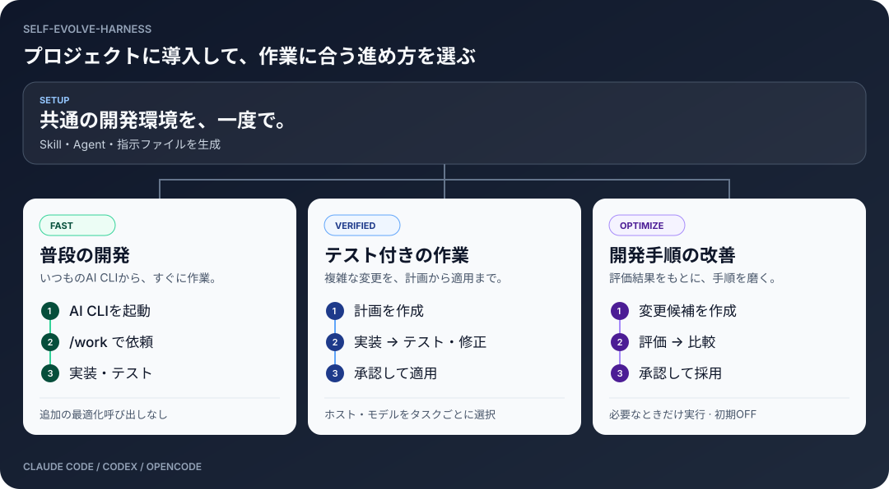

<div align="center">

# self-evolve-harness

**ひとつの依頼を、検証できる変更へ。**

Claude Code・Codex・OpenCodeを、計画・分担・テスト・承認でつなぐCLI。

[English](README.md) · **日本語**

<sub>Python 3.11+ &nbsp; / &nbsp; macOS・Linux &nbsp; / &nbsp; 最適化は初期OFF</sub>

</div>

## 何を任せられる？

<picture>
  <source media="(max-width: 600px)" srcset="docs/assets/workflow-ja-mobile.svg">
  
</picture>

**小さな修正は `/work`。複数ファイルの変更は、計画とテストを付けて実行。開発手順の改善も、評価してから採用できます。**

| こんなときに | できること |
|---|---|
| 「いつものAI CLIですぐ直したい」 | `/work`から実装・テスト。追加の最適化呼び出しなし |
| 「画面とAPIを分担して作りたい」 | タスクごとにホスト・モデルを選び、独立した作業を並列実行 |
| 「変更を確かめてから反映したい」 | 作業用コピーで実装・テスト・回数制限付き修正。明示的に承認して適用 |
| 「うまくいった手順を次にも活かしたい」 | 知見を保存・検索。Skill・プロンプトの変更を評価・比較して承認付きで採用 |

<sub>図はタスク定義による分担の例です。最適化は初期OFF。AGYは設定ファイル生成のみ対応です。</sub>

## 使い方

### 1. インストール

Python **3.11以上**、macOS / Linuxが必要です。このリポジトリのディレクトリで実行します。

```bash
python3 -m venv .venv
source .venv/bin/activate
python -m pip install -e .
seh --version
```

インストールせず試す場合は、`seh`の代わりに`python3 run_seh.py`を使えます。実際のAI作業には、利用するClaude Code / Codex / OpenCode CLIのインストールと認証が別途必要です。

### 2. プロジェクトに導入

`/path/to/project`を対象プロジェクトのパスに置き換えます。`--hosts`には利用するホストを指定してください（例：`claude,codex,opencode`）。

```bash
# 生成されるファイルと差分を確認
seh init --root /path/to/project --hosts codex --profile balanced

# 設定を生成して、状態を確認
seh init --root /path/to/project --hosts codex --profile balanced --apply
seh doctor --root /path/to/project
```

`balanced`は2つのSkill（`harness-init`・`work`）と4つのAgent定義をホストごとに生成します。

### 3. 普段の開発

対象プロジェクトでAI CLIを起動し、`/work`に作業を依頼します。

```text
/work タイムアウト値の入力チェックを追加して、関連テストを実行して
```

### 4. 計画・テスト付きで実行

以下はCodexの例です。`--host`を`claude`や`opencode`に変更できます。

```bash
cd /path/to/project

# 作業計画を生成
seh work plan --root . --goal 'タイムアウト値の入力チェックを追加' \
  --host codex --scope 'src/**,tests/**' --execute --out task.json

# task.jsonを確認し、checksにプロジェクトのテストコマンドを設定して実行
seh work run --root . --task task.json --host codex --trust-cli

# 出力されたrun_idで結果を確認
seh work status <run-id> --root .

# 計画・結果を確認後、再実行して成功した変更を適用
seh work run --root . --task task.json --host codex --trust-cli --apply --approve
```

`--scope`とテストはプロジェクトに合わせて変更してください。[Task JSON例](examples/multihost/task.json)ではホスト・モデル・テスト・依存関係を指定できます。

`--trust-cli`は外部CLIの実行を許可します。作業用コピーはOSサンドボックスではありません。実行条件は[セキュリティ](docs/SECURITY.md)を参照してください。

### 5. AI・APIなしで試す

このリポジトリのディレクトリで実行します。

```bash
# サンプルを一時ディレクトリへコピー
DEMO_ROOT=$(mktemp -d)
cp -R examples/demo_project/. "$DEMO_ROOT/"

python3 run_seh.py init --root "$DEMO_ROOT" --apply
python3 run_seh.py work run --root "$DEMO_ROOT" \
  --task "$DEMO_ROOT/work-task.json" --host mock --apply --approve
python3 run_seh.py eval run --root "$DEMO_ROOT" \
  --suite "$DEMO_ROOT/eval-suite.json" --host mock
cat "$DEMO_ROOT/result.txt"
```

`mock`はAIモデルではなく、オフライン動作確認用です。

### その他の操作

| 操作 | コマンド |
|---|---|
| 設定の差分確認 → 同期 | `seh sync --root .` → `seh sync --root . --apply` |
| メモを保存・検索 | `seh memory add '認証の有効期限を先に確認' --root .` / `seh memory search '認証' --root .` |
| コードを検索 | `seh code search 'timeout' --root .` |
| Skillを検査 | `seh author lint --root .` |
| 最適化の状態を確認 | `seh optimize status --root .` |
| CLI互換性情報を更新 | `seh hosts refresh` |
| モデル情報を更新 | `seh models refresh --host opencode` |
| 詳しい引数を確認 | `seh --help` / `seh work run --help` |

詳細：[機能一覧](docs/IMPLEMENTATION_MATRIX.md) · [ホスト・モデル・更新](docs/HOST_TASK_MODEL_UPDATES.md) · [互換性・制約](docs/COMPATIBILITY.md)
