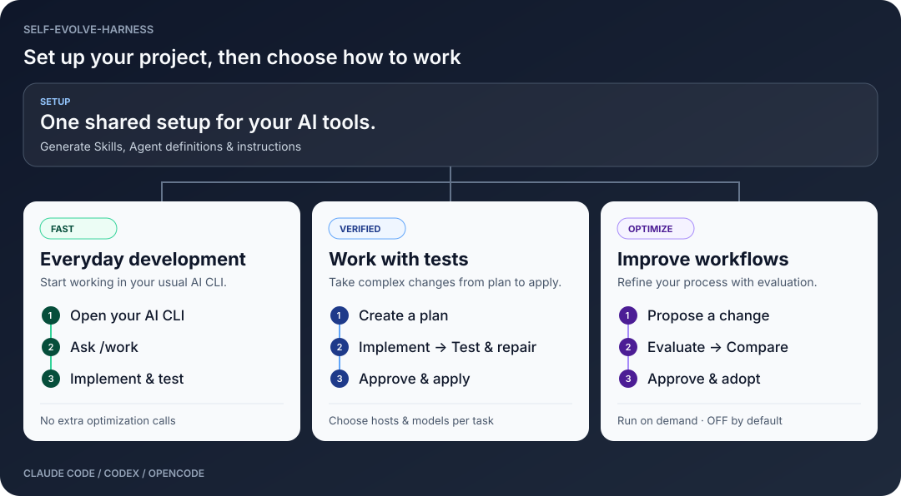

<div align="center">

# self-evolve-harness

**Shared workflows. Verified changes. Better AI coding.**

A development workflow CLI for Claude Code, Codex, and OpenCode

**English** · [日本語](README.ja.md)

<sub>Python 3.11+ &nbsp; / &nbsp; macOS &amp; Linux &nbsp; / &nbsp; Optimization OFF by default</sub>

</div>

## What can it do?

<picture>
  <source media="(max-width: 600px)" srcset="docs/assets/workflow-en-mobile.svg">
  
</picture>

| Goal | Capability |
|---|---|
| Set up your AI tools | Generate and sync host-specific Skills, Agent definitions, and instructions |
| Split up work | Choose hosts and models per task; run independent tasks in parallel |
| Verify changes | Run tests, bounded repairs, status checks, and explicit workspace apply |
| Improve workflows | Evaluate and compare Skills/prompts, approve promotion, and roll back |
| Reuse knowledge | Save and search local memory; search project code |

Everyday work adds no optimization calls. Improvement and optimization run only when requested (optimization is OFF by default). AGY supports configuration generation only.

## Usage

### 1. Install

Requires Python **3.11+** on macOS / Linux. Run from this repository's directory.

```bash
python3 -m venv .venv
source .venv/bin/activate
python -m pip install -e .
seh --version
```

To try without installing, replace `seh` with `python3 run_seh.py`. Real AI work also requires an installed and authenticated Claude Code, Codex, or OpenCode CLI.

### 2. Set up a project

Replace `/path/to/project` with your project path. Set `--hosts` to the hosts you use (for example, `claude,codex,opencode`).

```bash
# Preview generated files and changes
seh init --root /path/to/project --hosts codex --profile balanced

# Generate configuration and check setup
seh init --root /path/to/project --hosts codex --profile balanced --apply
seh doctor --root /path/to/project
```

The `balanced` profile generates two Skills (`harness-init`, `work`) and four Agent definitions per host.

### 3. Everyday development

Start your AI CLI in the target project and ask `/work` to do the task.

```text
/work Add timeout input validation and run the relevant tests
```

### 4. Run with a plan and tests

This example uses Codex. You can change `--host` to `claude` or `opencode`.

```bash
cd /path/to/project

# Generate a task plan
seh work plan --root . --goal 'Add timeout input validation' \
  --host codex --scope 'src/**,tests/**' --execute --out task.json

# Review task.json and set checks to your project's test commands before running
seh work run --root . --task task.json --host codex --trust-cli

# Inspect results using the run_id from the output
seh work status <run-id> --root .

# After reviewing the plan and results, rerun and apply successful changes
seh work run --root . --task task.json --host codex --trust-cli --apply --approve
```

Adjust `--scope` and tests to your project. The [Task JSON example](examples/multihost/task.json) shows hosts, models, tests, and dependencies.

`--trust-cli` permits external CLI execution. Working copies are not OS sandboxes. See [security](docs/SECURITY.md) for execution requirements.

### 5. Try without AI or an API

Run from this repository's directory.

```bash
# Copy the demo to a temporary directory
DEMO_ROOT=$(mktemp -d)
cp -R examples/demo_project/. "$DEMO_ROOT/"

python3 run_seh.py init --root "$DEMO_ROOT" --apply
python3 run_seh.py work run --root "$DEMO_ROOT" \
  --task "$DEMO_ROOT/work-task.json" --host mock --apply --approve
python3 run_seh.py eval run --root "$DEMO_ROOT" \
  --suite "$DEMO_ROOT/eval-suite.json" --host mock
cat "$DEMO_ROOT/result.txt"
```

`mock` is a deterministic offline test driver, not an AI model.

### Other operations

| Action | Command |
|---|---|
| Preview and sync configuration | `seh sync --root .` → `seh sync --root . --apply` |
| Save and search notes | `seh memory add 'Check auth expiry first' --root .` / `seh memory search 'auth' --root .` |
| Search code | `seh code search 'timeout' --root .` |
| Lint Skills | `seh author lint --root .` |
| Check optimization status | `seh optimize status --root .` |
| Refresh CLI compatibility information | `seh hosts refresh` |
| Refresh model information | `seh models refresh --host opencode` |
| See all options | `seh --help` / `seh work run --help` |

Details: [Capabilities](docs/IMPLEMENTATION_MATRIX.md) · [Hosts, models & updates](docs/HOST_TASK_MODEL_UPDATES.md) · [Compatibility & limitations](docs/COMPATIBILITY.md)
